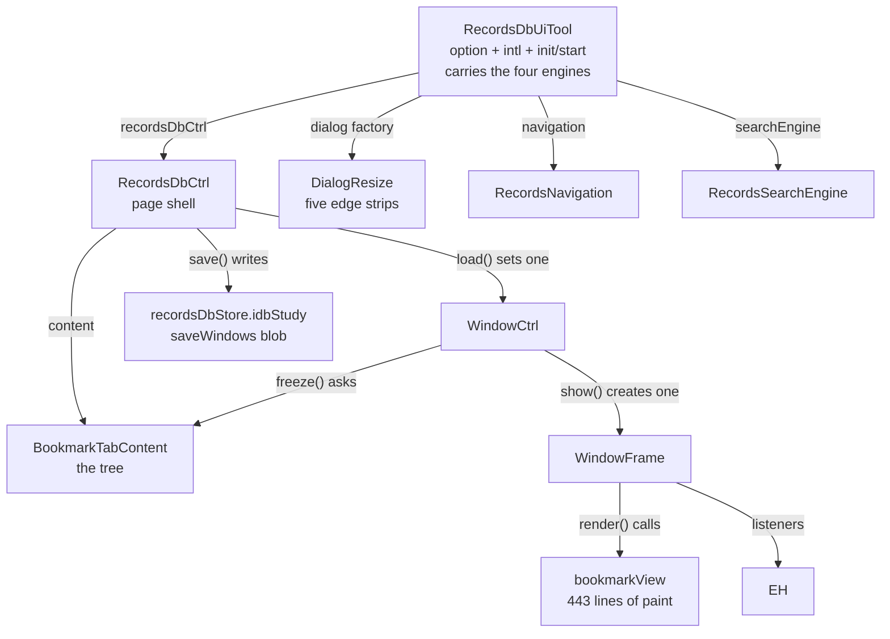
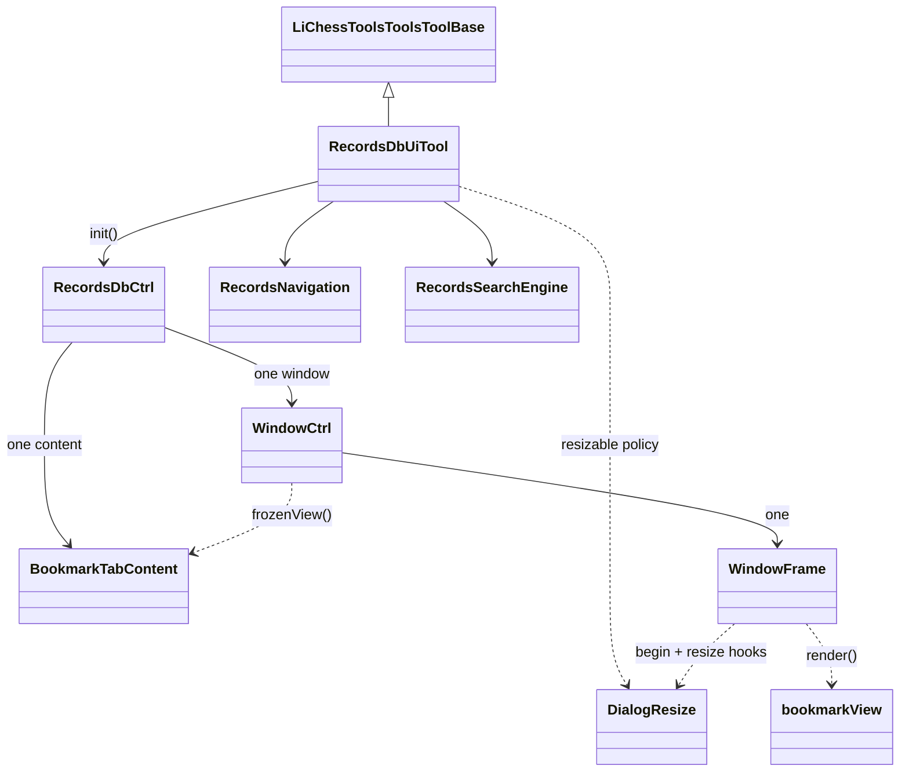
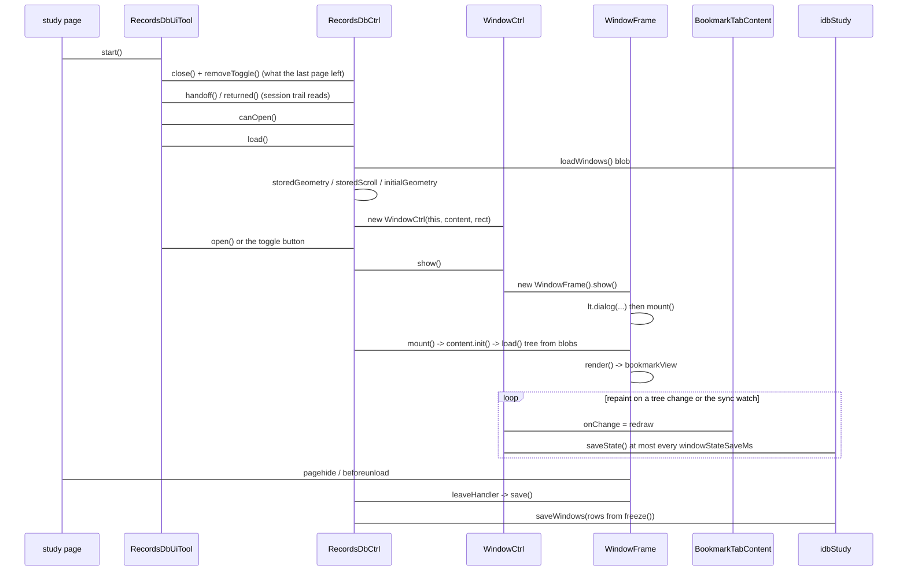
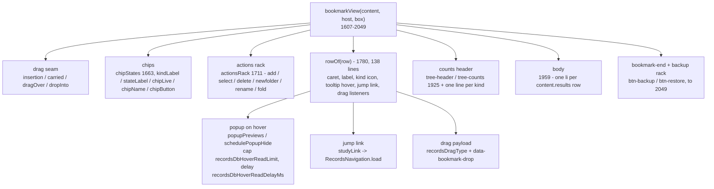
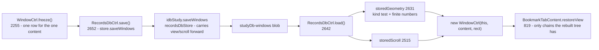

# recordsDbUi structure report

File: `tools/recordsDbUi/tool.js` - 2742 lines now, 2837 before the pass recorded
in sections 6-7.
Companion: `tools/recordsDbUi/tool.css` - 537 lines now, 547 before it.
Purpose: a map of the classes, methods and free functions in the file, with an
inventory of the weight that is not doing anything, so the code can be cut down
in ordered steps rather than guessed at.

Everything below is mechanical: the counts come from walking the file, and the
line numbers are the definition sites, so each claim can be checked.

## 1. The file anatomy

The file is one IIFE. There is no namespace export - the classes and helpers are
reachable through the tool instance: `RecordsDbUiTool.init` sets `recordsDbInstance`
to the tool itself, and the free helpers read the engines off that one instance.

| Unit | Kind | Lines | Span | What it is |
| --- | --- | --- | --- | --- |
| `RecordsDbUiTool` | class | 43-257 | 215 | the option tool; it carries the four engines, and 141 of its lines are the intl table |
| `BookmarkTabContent` | class | 262-1249 | 988 | the tree: state, load/save, filter, actions, its own read lifecycle |
| `RecordsSearchEngine` | class | 1252-1379 | 128 | the query filter over the tree |
| `RecordsNavigation` | class | 1382-1410 | 29 | row -> study page navigation |
| popup + row helpers | 17 free fns | 1413-1604 | 192 | jump link, tab key, tooltips, drag payload, match highlighting |
| `bookmarkView` | free fn | 1607-2049 | 443 | the whole paint of the tree view |
| geometry helpers | 5 free fns | 2051-2101 | 51 | viewport, clamp, fit, the resize policy |
| `DialogResize` (dialog tool) | class | outside this file | - | the five edge strips and the gesture a grab drives |
| `WindowCtrl` | class | 2204-2279 | 76 | window state: geometry, scroll, the blob write |
| `WindowFrame` | class | 2281-2477 | 197 | the DOM: dialog, hosts, scrollers, the resize policy |
| `RecordsDbCtrl` | class | 2479-2740 | 262 | the page shell: one window, the toggle, the trail, close |

Totals: 8 classes, 18 free functions, 120 members (the 8 constructors aside), 102
fields declared in constructors, 128 intl entries (65 unique keys). Classes and
functions account for 2663 lines; the rest is comments.

The ownership chain is single-file: `Tool -> Ctrl -> Content`, and the window
pair (`WindowCtrl` owning one `WindowFrame`) hangs off the same ctrl. Nothing
outside this file constructs any of these classes; the only outside reader is
`recordsDbStore/tool.js` (see section 9).

## 2. Class shape and the page lifecycle

There is no `extends` left in the file. The tab base `TabContentCtrl` and the
module holder `RecordsDbModule` both went: the base had exactly one subclass,
and the holder named four engines that the tool instance already owns. The
family the base came from is visible in the PR sources under
`test/_pr22258/` (`tabContentCtrl.ts`, `memberTabContent.ts`,
`resultTabContent.ts`, `historyTabContent.ts`) - the JS port kept the family and
dropped three of its four members, which is what left a base with one child.

Two notes for the reader: `WindowCtrl.constructor` subscribes to the sync watch
(`owner.store.syncCtrl.watch(this.redraw)`) and `RecordsDbCtrl.listenLeave()`
registers the unload listeners - both are how state reaches the blob when the
page is left without another tool call.

## 3. What each class holds

### `RecordsDbCtrl` (262 lines, 21 members) - the page shell

| Group | Members |
| --- | --- |
| window bookkeeping | `content`, `window`, `mount`, `open`, `close`, `toggle` |
| page trail | `pageStudyId`, `returned`, `handoff`, `rememberPage`, `listenLeave`, `stopLeave` |
| blob round trip | `load`, `save`, `storedGeometry`, `storedScroll` |
| the toggle button | `toggleHost`, `installToggle`, `removeToggle`, `toggleButton` |
| where the box goes | `canOpen`, `initialGeometry` (41 lines) |

The shell now keeps what it owns in plain fields: one `content` made in the
constructor, one `window` made by `load()` (2642) and cleared by `close()`
(2614). `mount()` (2561) stamps the paint order with `setOrder(0)` - the css
reads `---records-db-frame-order` and falls back to 900, so the write has to
survive; only the loop that used to feed it is gone.

### `BookmarkTabContent` (988 lines, 70 members) - the tree itself

| Concern | Members | Body lines |
| --- | --- | --- |
| identity + lifecycle | constructor, `init`, `destroy`, `load` (398), `save` (933), `logState` | 132 |
| branch blobs | `registry`, `studies`, `load`, `mergeBranches`, `splitBranches`, `sortTree`, `refreshCaches` | 69 |
| view state | `select`, `setSelect`, `toggle`, `toggleAllExpanded`, `folderNodes`, `shapeChains`, `frozenView`, `restoreView`, `filterChanged`, `clearSelection` | 92 |
| filter engine glue | `chipScope`, `chipApplicable`, `cycleFilter`, `haystackFor`, `searchQuery`, `passes`, `matchesQuery`, `rows`, `results`, `kindCounts`, `presentKinds`, `isGone`, `missingCount`, `filedCount`, `treeStudyIds`, `hoverRead` | 174 |
| tree editing | `at`, `contains`, `siblings`, `drag`, `canAttach`, `canDrop`, `drop`, `resolvePageLeaf`, `findLeaf`, `canAdd`, `addCurrentStudy`, `folderName`, `createFolder`, `removeSelected`, `countSelected`, `confirmCount`, `deleteSelected`, `editName`, `renameFolder` | 213 |
| file round trip | `previewRestore`, `restoreFromText`, `confirmRestore`, `applyRestore`, `downloadTree`, `openLeaf` | 78 |
| DOM hosts | `newFilterBox`, `viewHost` | 37 |
| row reading | `folder`, `leafLabel`, `recordFor`, `error` get/set | 11 |

`addCurrentStudy` (49 lines at 1036) and `hoverRead` (29 at 677) are the two
largest single members; `restoreView` (23 at 866) and `drop` (21 at 954) follow.

## 4. The paint layer - one function, 443 lines

`bookmarkView` (1607-2049) builds the whole view in one pass and keeps about 30
closures inside it. It is the largest unit in the file and the one place where
the tree's look is written.

The drag seams, the jump link and the tooltip hover are written inside `rowOf`,
so a tier C cut that removes drag or tooltips has to cut inside the row painter
as well - which is why `bookmarkView` is listed here as one unit rather than as
its parts. Row highlighting reads `highlightMatch`/`matchRanges`, and the tooltip
hover reads the popup helpers above it.

The same function reaches the tool through `recordsDbInstance.lichessTools`
rather than an argument - the free-function style is what makes the paint
reachable from `WindowFrame.render()` at all, and it is also what makes it
awkward to test in isolation.

## 5. The state round trip

`shapeChains` (784), `frozenView` (800) and `restoreView` (819) are the three
halves of the shape write; `saveWindows` in the store carries a `view` or a
`scroll` that a new row leaves out, which is what keeps a page that opens the
window before its tree is read from erasing the shape the page before left.

## 6. What the pass cut

The tier A and tier B rows below were applied on 2026-11-07 in one pass, with the
harness lines that named the old shape edited in the same pass. JS went 2837 ->
2742 (-95 lines); css went 547 -> 537 (-10).

| Cut | Weight | What replaced it |
| --- | --- | --- |
| `RecordsDbModule` | 10 lines, 5 fields, one hop on every engine read | the tool carries `recordsDbCtrl`, `navigation`, `searchEngine`; `init()` sets `recordsDbInstance = this`, and `maxResults` folded into the `recordsDbMaxResults` const |
| `TabContentCtrl` | 69 lines, 10 members, one subclass | `BookmarkTabContent` owns `init`, `destroy`, `logState`, its own `load`, its `error` get/set and the `frozenView` write |
| the base stubs: `get loading`, `get`/`set exhausted` + `exhaustedSlot`, `frozenView` stub, `closable`, `icon`, `label` | inside the 69 above | nothing reads any of them - the paging path they served went with the results tab |
| `listData` + its call at `viewHost` | 4 lines | the `data-key` attribute was written and read by nobody; `this.id` stays because it names the filter textbox's element id |
| `contentView` | 3 lines | `WindowFrame.render()` calls `bookmarkView` directly |
| `windowContents` Map, `get windows`, `hasWindow`, `bringToFront`, `closeWindow` | about 40 lines of bookkeeping and four loops | one `window` field: `load()` sets it, `close()` clears it, `open()`/`toggle()`/`listenLeave` read `window.windowFrame` |
| `.scrollable`, `.button-empty` css rules | 9 lines | no JS writes either class |

Harness lines moved with the code: `test/recordsDbUiWindow.check.js` (the
`shell` read, the one-content read, the `kept` list, the `gone` list) and
`test/recordsDbHarvest.check.js` (the `shell` read, the `onChange`/`destroy`
needles, the kept list, the paint needle). All three suites were green after the
pass: 578 + 71 + 105 checks, 0 failed.

Three traps that the pass had to keep, so the next reader need not repeat them:

- `setOrder` writes `---records-db-frame-order`, and the CSS fallback
  `var(---records-db-frame-order, 900)` (css 20) is a different number from
  the one it writes. The loop over several windows was dead shape; the write is
  not, so it survives as `setOrder(0)` in `mount()` and in
  the dialog factory's `DialogResize.begin()`.
- `dialog-resize-e/w/s/se/sw` and `.mobile` look unused to a string search but are live:
  `tools/dialog/tool.js` writes `class="dialog-resize"` and `addClass('dialog-resize-' + edge)`, and
  `body.lichessTools.mobile` is lichess's own class.
- 37 intl keys look unused to a string search and are all live, because the
  labels are composed: `'kind' + camel(kind)`, `which + camel(state)`,
  `'filters' + ...`, `'recordsDbCount' + camel(kind)`,
  `'recordsDb' + camel(content.message)`. Nothing in the table is spare.

Three checks that look worse than they are, so the next reader need not repeat
them:

- `setOrder` writes `---records-db-frame-order`, and the CSS fallback
  `var(---records-db-frame-order, 900)` (css 20, 342) is a different number from
  the one it writes - order starts at 0. The loop over one window is dead shape;
  the write itself is not, so the fix is one call at paint time, not a deletion.
- `dialog-resize-e/w/s/se/sw` and `.mobile` in the dialog sheet look unused to a string search
  but are live: `tools/dialog/tool.js` builds `addClass('dialog-resize-' + edge)`, and `body.lichessTools.mobile`
  is lichess's own class.
- 37 intl keys look unused to a string search and are all live, because the
  labels are composed: 1720 `'kind' + camel(kind)`, 1721 `which + camel(state)`,
  1723 `'filters' + ...`, 1978 `'recordsDbCount' + camel(kind)`, 2086-2087
  `'recordsDb' + camel(content.message)`. Nothing in the table is spare.

## 7. Residue that stays on purpose

These looked like the same kind of weight as section 6, and each one was kept for
a reason the next reader will otherwise miss.

| Item | Why it stays |
| --- | --- |
| the content kind `'treeTab'` | `storedGeometry` (2631) and `storedScroll` (2515) compare it against the word an old blob carries. Renaming it needs a migration that accepts the old name, or existing users lose their window box |
| the content id string `lichessTools-recordsDbUi-content-N` and `nextContentId` | the id names the filter textbox's element id (`#...-filter` at `newFilterBox`), a DOM handle a page could style or query - not dead weight |
| `recordsDbInstance` | the free helpers still need one handle to the engines. A class named "module" was the wrong shape for that; a field on the tool that points at the tool is the right one |
| the kind test inside `storedScroll` / `storedGeometry` loops | the fail-soft rule is real: a blob an older version wrote with other kinds must load the default box, not throw on page load |
| `bookmarkView` as one 443-line function | splitting it saves no lines; it is what makes the tier C cuts in section 8 local instead of surgery inside the painter |

## 8. Tier C - feature surfaces, with their real cost

These change behaviour, so each needs a decision. The lines listed are what
removing the surface takes, counting the member bodies and the paint that
builds the button.

| Surface | Lines | Members and paint | Notes |
| --- | --- | --- | --- |
| backup / restore through a file | 114 | `previewRestore` 2, `restoreFromText` 11, `confirmRestore` 17, `applyRestore` 15, `downloadTree` 12, rack paint 2036-2092 | the only file-io pair left in the tool; its intl keys travel with it |
| file the study this page carries | 84 | `canAdd` 2, `addCurrentStudy` 49, `folderName` 10, `createFolder` 12, add-button paint 1764-1774 | `addCurrentStudy` is the largest member in the file on its own |
| remove rows from the tree | 58 | `removeSelected` 11, `countSelected` 10, `confirmCount` 19, `deleteSelected` 7, delete-button paint | `confirmCount` is shared with the add path - one cannot go without the other's rework |
| rename a folder | 22 | `editName` 6, `renameFolder` 3, rename-button paint 1808-1820 | reuses `folderName` and the dialog prompt |
| hover read of a cold row | 130 | `hoverRead` 29 and the popup helpers 1485-1595 (101) | also the only reader of `recordsDbHoverReadLimit`/`recordsDbHoverReadDelayMs` |
| drag rows across pages | 89 | `drag` 12, `canAttach` 5, `canDrop` 5, `drop` 21, `clearDrop` 4, drag seams 1672-1713 | three of the seams sit inside `rowOf`, so they cannot go while rows are painted |
| clipboard transfer type | 6 | `recordsDragType` 4, its two tests at 1686 and 1693, the write at 1960 | part of the row above - one feature, both halves |

`Dialog`, `PageInitData` and `FixAbortController` in the dependency list
(tool.js:43) are all used: `lt.uiApi?.dialog` at 1092, 1153 and 1203,
`lt.pageInitData` at 1006, `AbortController` at 288 and 1441. No dependency in
that list is spare.

## 9. What must not go out

- `RecordsNavigation.load` is wrapped by the other tool: `tools/recordsDbStore/tool.js:1166`
  tests `isWrappedFunction(setChapter, 'recordsDbUi')`, so the navigation that patches
  chapter switching is what tells the store a chapter changed. Cutting the class cuts the
  capture, not just the jump.
- `lt.dialog({ class: 'records-db', noTabCycle: true, closedBy: 'none', noEscClose: true })`
  (2310-2318) is the DOM contract another harness reads
  (`test/recordsDbHarvest.check.js:471-473`).
- `data-expanded`, `data-bookmark-drop` and `data-popup` (css 284-321) and
  `---records-db-frame-order` (css 20) are read by the CSS; they are a paint
  contract. Only `data-key` is read by nothing, and it went with `listData`.
- `treeHandoffKey`, `treeReturnKey`, `treePageKey` (13-24) are read only in this file, but
  the back-button trip runs entirely through them.
- `test/recordsDbUiWindow.check.js` carries 578 checks, and its `kept`/`gone`
  lists plus the one-content reads name the internals this file owns. They move
  with the code, not after it - the same pass that cuts a member updates the
  lines that name it.
- `tools/recordsDbUi/context.md` records the invariants - the name chains, the carry in
  `saveWindows`, the hover-read cap. It stays true only if it is edited with the code.

## 10. What is left to do

Steps 1-3 of the old plan are done: the tier A cut, the folded base and the
single-window shape all landed, with the harness lines moved in the same pass.
What is left:

1. Split `bookmarkView` into named builders (`chips`, `actionsRack`, `rowOf`,
   `countsHeader`, `body`, `backupRack`). This saves no lines; it is what makes
   each row of section 8 a local edit instead of surgery inside 443 lines.
2. Tier C one row at a time from section 8, each with its harness update and its
   intl keys. None of them is free - the cheapest is the clipboard transfer type
   at 6 lines, and it is half of the drag feature.
3. Optional, and only with a migration: rename the content kind away from
   `'treeTab'`, and the id string away from the tab-shaped literal. Both name
   things an old blob or an old user css can carry.

After the pass above the file reads 2742 lines with the same behaviour. Only
step 2 reaches lower, and it needs a decision per row of section 8.

## 11. How this was measured

`test/_tmp_structure.mjs` walked the file by brace depth before the pass: class
headers at two spaces of indent, members at four, so each range is a real extent
rather than a guess. `test/_tmp_deadcheck.mjs` counted identifier mentions in
`tool.js` and matched CSS class names against the JS text. After the pass
`test/_tmp_cssdead.mjs` re-ran the CSS token scan - only the `dialog-resize-*` compounds
and `.mobile` looked dead, and both are live - and `test/_tmp_members.mjs`
counted members and constructor fields at the current line numbers. All were
scratch probes and are deleted; the numbers above are what they printed.

